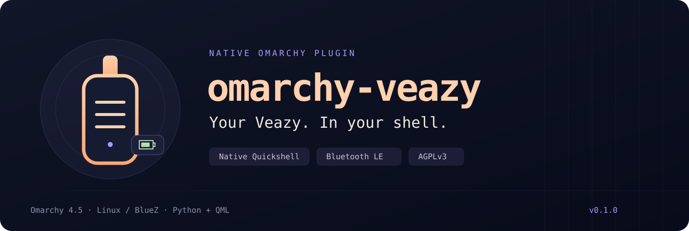
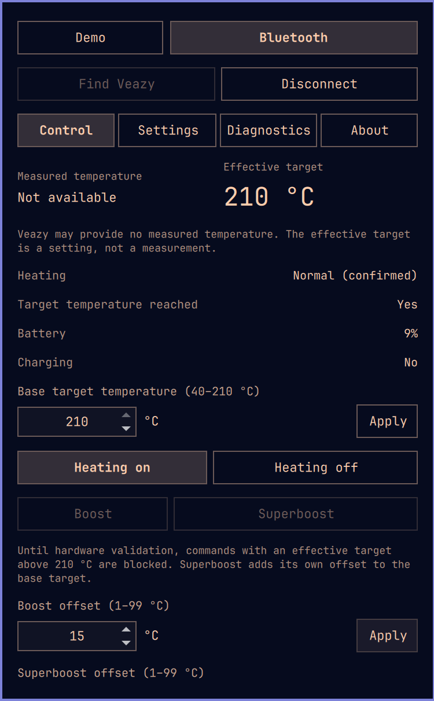

<p align="center">
  
</p>

<p align="center">
  <a href="docs/RELEASE_NOTES.md"></a>
  <a href="https://github.com/omacom/omarchy"></a>
  <a href="#how-it-works"></a>
  <a href="LICENSE"></a>
</p>

# Your Veazy, in the Omarchy bar

Control your Storz & Bickel **Veazy** directly from the native Omarchy shell. A small icon on the right opens temperature controls, battery status and device settings in a panel that follows your desktop theme.

**v0.1.0 is an early preview.** The native panel and live Bluetooth telemetry have been checked on a real Veazy. Heating, boost and settings writes are implemented and tested with a simulated transport; their hardware behavior still needs validation. See the [release notes](docs/RELEASE_NOTES.md) for the exact scope.

<p align="center">
  
  <br>
  <sub>Native panel on Omarchy.</sub>
</p>

## What you get

<p align="center">
  
  <br>
  <sub>Battery percentage stays visible in the bar.</sub>
</p>

- **Native shell controls** — a bar icon and themed Quickshell panel, with English and Dutch text.
- **Temperature and heating** — base target, effective target, explicit heater controls, boost and superboost.
- **Battery at a glance** — a battery gauge, percentage and charging status from device telemetry.
- **Device details** — supported vibration, brightness and charging options, diagnostics, connection state and clear errors. An offline demo lets you explore the panel first.

## Install

You need **Omarchy 4.5 with its official Quickshell plugin API**, Python and a working BlueZ Bluetooth LE adapter. The tested system uses Python 3.14 and BlueZ 5.87 on an Intel MacBook Pro.

```bash
omarchy plugin add https://github.com/Xenophon81/omarchy-veazy.git --enable
bash ~/.config/omarchy/plugins/io.github.xenophon81.veazy/scripts/setup-backend
```

The first command installs the plugin and adds its icon to the right of the bar. The second installs the pinned Bluetooth dependencies into a user virtual environment under `~/.local/share/omarchy-veazy/venv` (or `$XDG_DATA_HOME/omarchy-veazy/venv`). Daily use runs as your normal user.

The plugin starts in **Demo** mode. It never installs dependencies, scans or connects when the shell starts.

## Connect your Veazy

1. Click the Veazy icon on the right of the bar.
2. Select **Bluetooth**, then **Find Veazy**.
3. Select your `S&B VZ` device and choose **Connect selected device**.
4. Check its state before using the controls. A new target is sent only when you click **Apply**; heating and boost each require their own explicit action.

Connecting and reconnecting only read device state. Commands are never replayed after a disconnect or worker restart. After connection loss, the heater state is **unknown**; the device can continue heating independently.

## Current limits

| Area | v0.1.0 behavior |
| --- | --- |
| Live telemetry | Battery, charging, target and heater mode were observed on a real Veazy through BlueZ. |
| Measured temperature | The tested Veazy returns `0x8000`, meaning unavailable. The panel displays **Not available** and keeps measured temperature separate from target settings. |
| Temperature range | Base target: 40–210 °C. Effective targets above 210 °C are blocked pending hardware validation, including during boost. |
| Boost | Superboost uses the base target plus its own offset, following the upstream implementation. Actual firmware behavior remains to be checked. |
| Settings | Controls depend on fields reported by the device. Charging-current optimization and charging-voltage limiting are separate settings. Hardware writes remain unverified. |
| Uncertain commands | A timeout or ambiguous result blocks further changes until an explicit reconnect. One explicit, visibly unconfirmed heater-off request remains available. |
| Device support | Veazy only. Firmware updates, factory reset and other vaporizer models are outside this release. |

The supported host is Omarchy's built-in bar. Alternate bars, multiple monitors and additional firmware versions still need testing.

## Update or disable

```bash
omarchy plugin update io.github.xenophon81.veazy
bash ~/.config/omarchy/plugins/io.github.xenophon81.veazy/scripts/setup-backend
```

Run dependency setup after an update that changes `requirements.txt`. To disable the icon, use `omarchy plugin disable io.github.xenophon81.veazy`; removal is available through Omarchy's plugin manager. The separate user virtual environment is retained.

## How it works

```text
Omarchy bar → native QML panel → shared QML service
                                       ↕ JSON Lines
                                Python controller
                                       ↕ Bleak / BlueZ
                                    Your Veazy
```

The existing Quickshell process hosts the interface. One shared backend serves every panel, keeping presentation, connection management and protocol encoding separate. Bluetooth runs through Linux BlueZ; opening the panel starts no browser or separate application.

## Development

```bash
PYTHONPATH=backend python3 -m unittest discover -s tests -v
omarchy plugin validate .
python3 scripts/check-qml
```

The tests cover protocol frames, missing data, temperature limits, serialized operations, timeouts, IPC validation and startup without automatic heating. QML checks exercise the mock service, idle worker, helpers and native component compilation. Hardware observations are recorded separately.

To install a local checkout, run `bash scripts/install-local`, then `bash scripts/setup-backend`. The local installer creates a copy and refuses to overwrite an existing installation. A local copy does not support Git updates; use the GitHub installation above for those.

Architecture, the implementation plan and detailed evidence are in [docs/PROJECT.md](docs/PROJECT.md) (Nederlands). Contributors should read [AGENTS.md](AGENTS.md). Bug reports are welcome through [GitHub Issues](https://github.com/Xenophon81/omarchy-veazy/issues); include your Omarchy, Python and BlueZ versions, and remove device addresses and serial numbers from logs.

## Credits and license

**[Reactive Volcano App by Tristan Teufel](https://github.com/firsttris/reactive-volcano-app)** provides the upstream Veazy protocol implementation. This project's Python protocol port is based on commit `9d773eff709d721e0e79b403ac2258ba5a851d6c`; the native UI, BlueZ transport, IPC and controller are project-specific adaptations.

Distributed under **AGPL-3.0-only**. See [LICENSE](LICENSE) and [NOTICE](NOTICE), including the upstream attribution terms. Omarchy components are imported from the system installation. The project icon and banner are original vector artwork.
