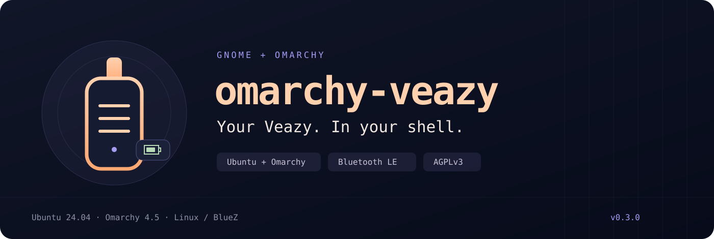
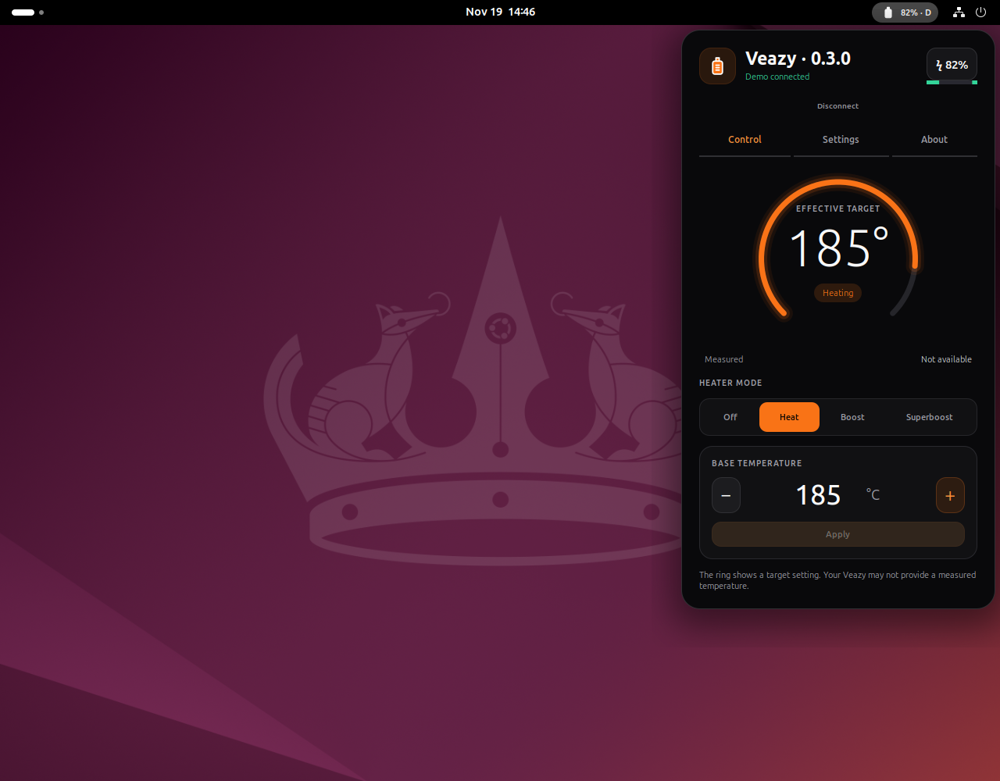

<p align="center"></p>

# Veazy voor Ubuntu en Omarchy

Bedien je Storz & Bickel **Veazy** vanuit de bestaande bovenbalk. Een native paneel toont temperatuurinstellingen, verwarmingsmodi, batterij en apparaatinstellingen. Er draait geen browser of aparte desktopapp.

**Preview 0.3.0** verbetert statusanimaties en updates. Veazy biedt een GNOME Shell-extensie voor **Ubuntu 24.04 LTS / GNOME 46**, geschikt voor **X11 en Wayland**. De bestaande Omarchy-plugin blijft beschikbaar. Beide gebruiken dezelfde Python/Bleak-backend en dezelfde protocolbeveiligingen. De GNOME-interface volgt de donkere vormgeving en oranje temperatuurboog van [Reactive Volcano App](https://github.com/firsttris/reactive-volcano-app).

> Verwarming, temperatuur-, boost- en instellingenwrites zijn met een gesimuleerd transport getest. Hun werking op een fysieke Veazy is nog niet bevestigd. Eerdere hardwarewaarnemingen betreffen passieve telemetrie; zie [hardwaretests](docs/HARDWARE_TESTS.md).

<p align="center"><br><sub>GNOME Shell 46 op Ubuntu · offline demo met opwarm- en laadstatus, geen hardwaremeting.</sub></p>

## Ubuntu 24.04 LTS installeren

Download `veazy@xenophon81.github.io.shell-extension.zip` bij de [nieuwste release](https://github.com/Xenophon81/omarchy-veazy/releases). Installeer het pakket:

```bash
gnome-extensions install veazy@xenophon81.github.io.shell-extension.zip
```

Installeer daarna expliciet de Bluetooth-dependencies:

```bash
# Alleen nodig als Python-venv of BlueZ ontbreekt:
sudo apt install python3-venv bluez

bash ~/.local/share/gnome-shell/extensions/veazy@xenophon81.github.io/scripts/setup-backend
```

**Meld je af en opnieuw aan**, op zowel X11 als Wayland. Activeer vervolgens:

```bash
gnome-extensions enable veazy@xenophon81.github.io
```

Het Veazy-icoon verschijnt rechts in de bestaande GNOME-balk. De extensie begint in **Demo**; openen of aanmelden start geen Bluetooth-scan of verbinding. Je kunt de vormgeving en bediening eerst offline bekijken via **Demo → Ontdek de demo → Verbind** (Engelstalige desktop: **Explore the demo → Connect**).

Voor installeren vanuit deze repository:

```bash
python3 scripts/gnome-extension build
python3 scripts/gnome-extension install
bash scripts/setup-backend
```

De lokale installer bewaart een bestaande extensieversie buiten de extensiemap. Hij wijzigt geen andere extensies of shellinstellingen. [Uitgebreide Ubuntu-instructies](docs/GNOME.md) beschrijven updates, uitschakelen en probleemoplossing.

## Omarchy installeren

Voor Omarchy 4.5 met de officiële Quickshell-plugin-API:

```bash
omarchy plugin add https://github.com/Xenophon81/omarchy-veazy.git --enable
bash ~/.config/omarchy/plugins/io.github.xenophon81.veazy/scripts/setup-backend
```

De widget staat standaard rechts en opent een native Quickshell-paneel. Voor een lokale checkout: `bash scripts/install-local`. Die installer weigert een bestaande installatie te overschrijven. Update een Git-installatie met `omarchy plugin update io.github.xenophon81.veazy`; voer dependencysetup opnieuw uit als `requirements.txt` is gewijzigd.

De bronbestanden staan nu onder `platforms/omarchy/`; het officiële manifest blijft aan de repositoryroot voor bestaande Omarchy-installatie-URL's.

## Verbinden en bedienen

1. Klik op het Veazy-icoon en kies **Bluetooth**.
2. Kies **Zoek Veazy**, selecteer je `S&B VZ` en verbind. Zoeken en verbinden gebeuren uitsluitend na jouw actie.
3. Controleer de apparaatstatus. Een bewerkte temperatuur blijft een concept tot **Toepassen**. Verwarmen, stoppen, boost en superboost hebben afzonderlijke knoppen.

De bediening onderscheidt **basisdoel**, **effectief doel** en **gemeten temperatuur**. De Veazy geeft mogelijk geen echte temperatuurmeting door; dan staat er *Niet beschikbaar*. De oranje ring toont het effectieve doel, nooit een geschatte meting of verzonnen opwarmvoortgang.

Batterijpercentage verschijnt in het paneel en naast het balkicoon. In demo is het percentage als simulatie herkenbaar. Bij onbekende, verouderde of verbroken status verdwijnt het percentage. **Een verbroken verbinding betekent niet dat het apparaat is gestopt met verwarmen.**

Na een timeout of onduidelijke uitkomst zijn wijzigingen geblokkeerd tot een expliciete reconnect. Eén bewuste, zichtbaar onbevestigde heater-uit-opdracht blijft mogelijk. Opdrachten worden nooit automatisch herhaald of na een herstart opnieuw verstuurd.

## Functies en grenzen

| Onderdeel | Gedrag |
| --- | --- |
| Bediening | Basisdoel 40–210 °C; expliciet verwarmen/stoppen; boost/superboost met afzonderlijke offsets. |
| Effectief doel | Tijdelijk begrensd op 210 °C, ook bij wijzigen van offsets of basisdoel in actieve boost. |
| Instellingen | Alleen uitgelezen vibratie, helderheid, boost- en laadopties; geen fictieve algemene eco-bit. |
| Gegevens | Firmware, serienummer, runtime, laadtijd en ruwe diagnostiek. |
| Taal | Nederlands en Engels; GNOME volgt de desktoptaal. |
| Compatibiliteit | GNOME Shell 46 op Ubuntu 24.04; Omarchy 4.5. Andere GNOME-majeurversies worden niet zonder tests gedeclareerd. |
| Buiten scope | Firmware-updates, factory reset, andere apparaatmodellen en automatisch verbinden. |

## Projectindeling en ontwikkeling

```text
platforms/gnome/          native GNOME Shell 46-extensie (GJS / St / Cairo)
platforms/omarchy/        native Omarchy-interface (QML / Quickshell)
backend/omarchy_veazy/    gedeelde protocolcodec, controller, BlueZ en JSONL-IPC
manifest.json            officiële Omarchy-pluginroot
scripts/                 backendsetup, installers, packaging en UI-controles
tests/                   protocol, fake transport, IPC en GNOME/QML-checks
docs/                    architectuur, hardwarebewijs en release notes
```

De Python-pakketnaam en venv-locatie `~/.local/share/omarchy-veazy/venv` blijven behouden voor bestaande installaties. Dependencies staan buiten beide interfaces en worden alleen via expliciete setup geïnstalleerd. Dagelijks gebruik vereist geen roothelper, webserver of aangepaste brede Bluetoothrechten.

```bash
PYTHONPATH=backend python3 -m unittest discover -s tests -v
node tests/gnome/model.test.mjs
gjs -m tests/gnome/client.js
python3 scripts/gnome-extension build

# Geïsoleerde GNOME-tests, zonder Bluetooth (X11 gebruikt Xephyr):
python3 scripts/check-gnome-shell --session wayland
python3 scripts/check-gnome-shell --session x11

# Op een Omarchy-machine:
omarchy plugin validate .
python3 scripts/check-qml
```

GNOME-tests starten een eigen testshell met tijdelijke configuratie en sluiten die automatisch. Ze vervangen de actieve desktop niet. De Omarchy-laadtest vereist de daar geïnstalleerde shell en Quickshell; op Ubuntu is die niet beschikbaar.

Zie [release notes](docs/RELEASE_NOTES.md), [architectuur en onderzoeksbronnen](docs/PROJECT.md), [GNOME-installatie](docs/GNOME.md) en [bijdrage-instructies](AGENTS.md).

## Bronnen en licentie

Protocolport en visuele inspiratie: **[Reactive Volcano App by Tristan Teufel](https://github.com/firsttris/reactive-volcano-app)**, commit `9d773eff709d721e0e79b403ac2258ba5a851d6c`. De native interfaces, transport, IPC en controller bevatten eigen implementaties. Het GNOME-icoon is oorspronkelijke vectorillustratie; webassets en fonts zijn niet overgenomen.

[storz-rs van flakesonnix](https://github.com/flakesonnix/storz-rs), onderzocht op `07bf74be90b705eb3d2caa783542976b16c0f78a`, is een aanvullende protocolreferentie. Dat project vermeldt Veazy als nog niet op hardware getest. Er is geen Rust-code uit overgenomen en er is geen tweede backend toegevoegd.

Dit project blijft **AGPL-3.0-only**. [LICENSE](LICENSE) en [NOTICE](NOTICE) bevatten de volledige licentie en upstreamattributie; de native informatiepagina toont de vereiste credits. Onafhankelijk project, niet verbonden aan Storz & Bickel.
