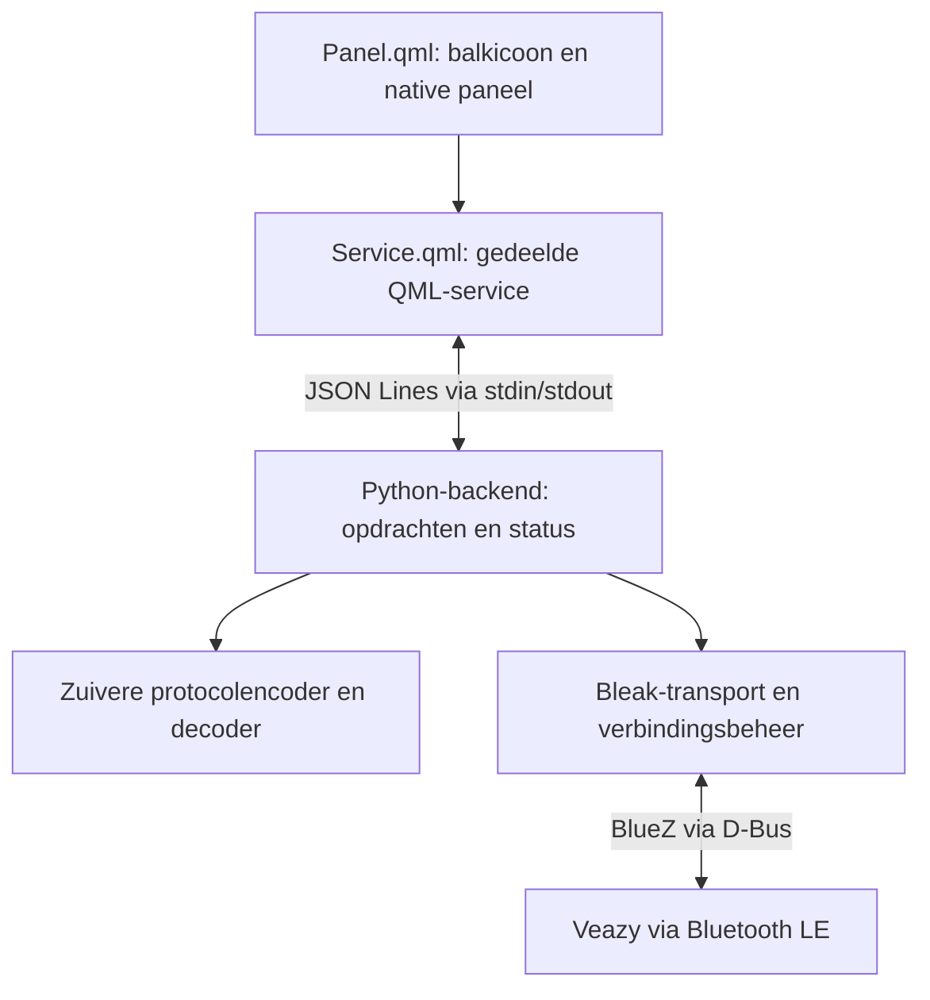

# omarchy-veazy

## Status en opdracht

**Preview 0.1.0:** accupercentage en laadstatus zijn op echte Veazy-telemetrie bevestigd. Het percentage verschijnt naast het balkicoon en in een prominente accukaart bovenaan het paneel. Zie [hardwarewaarnemingen](HARDWARE_TESTS.md) en [release notes](RELEASE_NOTES.md). Verwarmings-/instellingswrites blijven buiten de door ons uitgevoerde hardwaretests.

Onderzoeksdatum: **5 november 2026**. De eerste analyse is vastgelegd in commit `a3c2f80`. Naar aanleiding van de vervolgvraag over een actieve native interface is de implementatie toegevoegd: rootmanifest, native QML-paneel, gedeelde mock/live-service, Python/Bleak-backend, offline tests en installatie-instructies. De gebruiker gaf daarna expliciet toestemming voor lokale activatie en dependencysetup; de plugin staat nu zichtbaar rechts in de bovenbalk. Apparatuurbediening en volledige werking op echte hardware zijn nog niet geverifieerd.

Zie [README.md](../README.md) voor de uitgevoerde opdrachten voor lokale activatie en dependencysetup. De installer heeft de bestaande shellconfiguratie geback-upt en de widget via de officiële API geactiveerd. Het paneel biedt de relevante Veazy-bediening; gelijkwaardige werking op echte hardware is nog geen bewezen resultaat. Firmware-updates, factory reset en andere apparaatmodellen vallen buiten de eerste versie.

Doel: een Storz & Bickel **Veazy** bedienen vanuit een icoon rechts in de bestaande Omarchy-balk. Klikken opent een native Quickshell-paneel binnen de bestaande shell. Geen aparte desktopapp, browser, PWA, Electron, Chromium of vervangende balk.

## 1. Gecontroleerd doelsysteem

Onderstaande gegevens zijn lokaal uitgelezen; ze zijn geen veronderstellingen op basis van de projectomschrijving.

| Onderdeel | Vastgesteld |
|---|---|
| Omarchy | `omarchy version` en pacman: **4.5.0-3**; `/etc/os-release`: 4.5.0 |
| Quickshell | `0.3.2.r7.g2b4501a-1` |
| Qt Declarative | `6.12.0-2` |
| Machine | Apple `MacBookPro15,2`, `x86_64` |
| Python | `3.14.8-1` |
| Bluetooth | BlueZ en bluez-utils `5.87-2`; `bluetooth.service` actief; default controller beschikbaar |
| Bleak | Pacmanpakket `python-bleak` ontbreekt; `importlib.util.find_spec("bleak")` vindt geen module in de systeem-Python |
| Shell | Draait als `quickshell -n -p /usr/share/omarchy/shell` |

Het losse bestand `/usr/share/omarchy/version` bevat `4.0.0.alpha`. Het geïnstalleerde `omarchy-version`-script gebruikt bij deze pakketinstallatie de pacmanversie. We richten ons daarom op **4.5.0-3**. Een inactieve systemd-userunit met de naam `omarchy-shell.service` betekent hier niet dat de shell niet draait: het proces is afzonderlijk bevestigd.

BlueZ/controllerbeschikbaarheid bewijst nog geen werkende BLE-verbinding, notifications of schrijftoegang voor deze Veazy. De actuele apparaatfirmware en GATT-properties zijn nog onbekend.

## 2. Officiële plugin-API

De geïnstalleerde bron is gelezen en vergeleken met de officiële [shellreferentie][omarchy-api] en [pluginhandleiding][omarchy-plugins]. De GitHub-verwijzing `basecamp/omarchy` verwijst inmiddels naar `omacom/omarchy`; onderzochte branch `quattro`, commit `6194f4606c585da8b839b87df9120b7d796afedf`. De lokale installatie blijft leidend voor runtimegedrag.

| Onderwerp | Ondersteund contract / ontwerp |
|---|---|
| Distributie | Git-repository met `manifest.json` aan de root |
| Manifest | `schemaVersion: 1`; `id`, `name`, `version`, `kinds`, `entryPoints` verplicht |
| Plugin-id | Voorgesteld: `io.github.xenophon81.veazy`; `omarchy.*` is gereserveerd |
| Onderdelen | `kinds: ["bar-widget", "service"]`; `entryPoints.barWidget: "Panel.qml"`, `entryPoints.service: "Service.qml"` |
| Plaatsing | `barWidget.defaultSection: "right"`, `allowMultiple: false` |
| Native bediening | `qs.Ui.Panel`, `BarIconButton`, verankerde `KeyboardPanel` |
| Eigen gedeelde service | Binnen de widget via `bar.shell.serviceFor(moduleName)`; facade is beperkt tot de eigen plugin |
| Gebruikerslocatie | `~/.config/omarchy/plugins/<plugin-id>/` |
| Validatie | `omarchy plugin validate .`; controleert manifest/paden/bestanden, geen QML-runtime |
| Herladen | Gebruikersplugins worden gevolgd; expliciete rescan via `omarchy-shell shell rescanPlugins` mogelijk |

`right` betekent direct zichtbaar rechts in de balk. `tray` is de inklapbare traydrawer en past niet bij het gevraagde zichtbare icoon. De plugin verandert de globale balkpositie niet; rechtsboven geldt voor een bovenaan geplaatste balk.

Een balkwidget wordt per monitor aangemaakt. De officiële service-loader maakt daarentegen één serviceobject per plugin-id. Daarom komt het Python-proces in `Service.qml`, niet in het paneel. `allowMultiple: false` voorkomt dubbele configuratie, maar vervangt deze gedeelde-servicearchitectuur niet.

De ingebouwde `omarchy.bar` is de eerste ondersteunde host. De officiële API geeft service-backed widgets onder een derdepartij-vervangingsbalk minder mogelijkheden; ondersteuning daarvan is geen aanname voor de eerste versie. Gebruik uitsluitend de eigen facade, zonder hostobjecten via de QML-objectboom te benaderen.

Lokale bewijspunten:

- `/usr/share/omarchy/bin/omarchy-plugin-validate`: schema, veilige entrypoints, gereserveerde id en verbod op symlinks binnen een plugin.
- `/usr/share/omarchy/shell/Ui/Panel.qml` en `KeyboardPanel.qml`: lifecycle, focus, verankering en native paneelgedrag.
- `/usr/share/omarchy/shell/plugins/panels/tailscale/Panel.qml`: voorbeeld van icoon met paneel; geen first-party rechten overnemen.
- `/usr/share/omarchy/shell/shell.qml`, `ensureService`: één serviceobject per id.
- `/usr/share/omarchy/shell/services/PluginShellApi.qml`: toegang tot eigen service.
- `/usr/lib/qt6/qml/Quickshell/Io/quickshell-io.qmltypes`: `Process.command`, `stdinEnabled`, `write(...)`, stdout/stderr en exitstatus beschikbaar.

## 3. Onderzocht Veazy-protocol

Referentie: [Reactive Volcano App][upstream], vastgezet op commit **`9d773eff709d721e0e79b403ac2258ba5a851d6c`**, van 4 november 2026. Bestudeerd: [protocol.ts][protocol], [driver.ts][driver], [store.ts][store], [docs/protocol.md][protocol-doc] en [docs/architecture.md][architecture-doc]. Modeldetectie, instellingen-UI, UUID-definities en licentiebestanden zijn aanvullend onderzocht. Dit is kennis uit upstream, nog geen bevestiging op de eigen Veazy.

### Transport en frames

De UUIDs komen uit [upstream UUID-definities][uuids]; frames en commando's uit [protocol.ts][protocol].

| Definitie | Werkelijke upstreamwaarde |
|---|---|
| Primary service | `00000000-5354-4f52-5a26-4249434b454c` |
| Control characteristic | `00000001-5354-4f52-5a26-4249434b454c` |
| Communicatie | Requests schrijven en responses als notifications op dezelfde characteristic |
| Commandobyte | Byte 0; response begint met hetzelfde commando |
| Requestlengte | Doorgaans 20 bytes; speciale brightness/vibration-requests 7 bytes |
| Leesrequest | Commandobyte, overige bytes nul; geen STATUS-write-mask |
| Numerieke velden | Little-endian, behalve expliciet afzonderlijk behandelde bytes |

Response-lengtes verschillen per commando. Upstream accepteert bijvoorbeeld STATUS vanaf 15 bytes, permanent-Bluetooth-data vanaf 17 bytes, firmware vanaf 19 en analyse vanaf 3 bytes. Een decoder mag dus niet iedere notification als een compleet 20-byte STATUS-frame behandelen. Ontbrekende optionele data blijft onbekend.

| Commando | Opcode | Functie |
|---|---|---|
| STATUS | `0x01` | Temperaturen, offsets, batterij, heatermodus en instellingen |
| FIRMWARE | `0x02` | Firmware-/bootloaderversie en modusflags |
| ANALYSIS | `0x03` | Foutcode en foutcategorie |
| EXTENDED_DATA | `0x04` | Heater-runtime en laadtijd |
| DEVICE_DATA | `0x05` | Serienummer en optionele kleurindex |
| BRIGHTNESS_VIBRATION | `0x06` | Helderheid, vibratie, boost-timeout |
| FIND_MY_DEVICE | `0x0d` | Vindactie; byte 1 is `0x01` |
| ADVERTISING_INFO | `0x1d` | Status van Find My Device |

Relevante STATUS-velden en schrijfmaskers uit [protocol.ts][protocol]:

| Functie | Byte(s) | Codering / masker in byte 1 bij wijzigen |
|---|---|---|
| Actuele temperatuur | 2–3 | uint16, tienden °C; sentinel `0x8000` |
| Basisdoel | 4–5 | uint16, tienden °C; masker `0x02` |
| Boost-offset | 6 | Hele °C; masker `0x04` |
| Superboost-offset | 7 | Hele °C; masker `0x08` |
| Batterij | 8 | Percentage |
| Heatermodus | 11 | 0 uit, 1 normaal, 2 boost, 3 superboost; masker `0x20` |
| Laadstatus | 13 | Groter dan nul betekent laden |
| Instellingen | Waarde 14, bitmasker 15 | STATUS-write-mask `0x80` |
| Instellingen 2 | Waarde 16, bitmasker 17 | STATUS-write-mask `0x80`; bit `0x01` permanent Bluetooth |

Upstream begrenst het basisdoel op **40–210 °C**, offsets elk op **1–99 °C** en helderheid op **1–9**. Requests gebruiken hele graden, gecodeerd als tienden bij het basisdoel. Native IPC accepteert voor deze instellingen gehele graden; geen onbedoelde verschillen door Python- versus JavaScript-afronding introduceren. Bewaar ontvangen ruwe temperatuurvelden totdat sentinel en validiteit zijn beoordeeld.

### Functionele bevindingen en beperkingen

**Actuele temperatuur:** [upstreamdocumentatie][protocol-doc] meldt dat het meetveld in praktijk steeds `0x8000` bevat: niet gemeten. De upstreamdecoder rekent dit desondanks om naar 3277 °C, terwijl de UI het effectieve doel gebruikt. Die inconsistentie nemen we niet over. Het model krijgt `current_temperature_c: null` met beschikbaarheidsstatus en de UI toont **Niet beschikbaar**. Alleen een geldige echte meting mag als actuele temperatuur verschijnen; doeltemperatuur en doel-bereikt-status krijgen eigen labels.

**Boost:** upstream berekent normaal het basisdoel, bij boost `basis + boost-offset`, bij superboost `basis + superboost-offset`. Superboost telt daar dus niet beide offsets op. De berekening begrenst het effectieve doel niet op 210 °C. Deze semantiek en de fysieke grens moeten op de echte Veazy worden gevalideerd. Tot die tijd is het ontwerp conservatief: geen actieve boost/superboost-opdracht toestaan waarvan het berekende doel boven 210 °C ligt; geen stilzwijgende begrenzing of wijziging van opgeslagen offsets. Dit is een tijdelijke UI/servicebeperking, geen bewezen apparaatregel.

Dezelfde tijdelijke grens geldt voor basisdoel- en offsetwijzigingen terwijl boost/superboost actief is. Elke mutatie wordt tegen de actuele bevestigde modus en waarden beoordeeld. Bij onbekende/verouderde heatermodus geen verhogende mutaties toestaan; een expliciete heater-uit-opdracht blijft beschikbaar wanneer de verbinding en applicatiemodus dat toelaten.

**Instellingen:** de gedeelde implementatie en [instellingen-UI][settings-ui] kennen vibratie, helderheid, boostvisualisatie, uitschakelen van de boost-timeout, temperatuureenheid en twee laadopties. Er is geen aangetoonde algemene eco-charging-bit:

- Laadstroomoptimalisatie: settingsbyte 14, bit `0x08`.
- Laadspanningsbegrenzing: settingsbyte 14, bit `0x20`.
- Boostvisualisatie: bit `0x40`, op Veazy geïnverteerd.
- Helderheid: `0x06`, byte 2, write-mask `0x01`.
- Vibratie: `0x06`, byte 5, write-mask `0x08`.
- Boost-timeout uitgeschakeld: `0x06`, byte 6, write-mask `0x10`.

De upstreaminstellingen-UI toont permanent Bluetooth en Find My Device specifiek voor Veazy. Firmwareondersteuning en de precieze werking van laadopties moeten nog worden bevestigd. Toon concrete namen; markeer onbekende/ontbrekende instellingen als niet beschikbaar. Factory reset heeft een upstreamencoder, maar valt buiten de eerste productscope.

**Diagnostiek:** firmwareflags, serienummer, runtime en laadtijd kunnen worden uitgelezen. Runtime/laadtijd zijn uint24 minuten. ANALYSIS levert ruwe foutcode en categorie; upstream noemt alleen categorie 4 expliciet een gedetecteerd probleem. Maak geen eigen fabrikantdiagnose bij onbekende codes. Geen firmware-updatefunctionaliteit. Gewone bediening blijft geblokkeerd bij bootloader-/ongeldige applicatiestatus totdat de betekenis is afgehandeld. De shutdown-timerbytes 9 en 10 worden upstream opgeteld; behandel ze niet zonder bewijs als uint16.

**Identiteit:** de [upstream BluetoothProvider][provider] herkent `S&B VZ` als Veazy en `S&B VY` als Venty, met bredere discovery-prefixen `STORZ&BICKEL`, `Storz&Bickel` en `S&B`. De service-UUID wordt gedeeld. Discovery toont kandidaten; de gebruiker selecteert het apparaat, daarna worden naam/model, GATT en beschikbare apparaatdata gecontroleerd. Een onbekend model krijgt geen verwarmingsbediening. Een serienummer alleen bewijst het model niet.

### Initialisatie, polling en bevestiging

De driver activeert notifications; de store subscribet vóór de initiële requests. Volgorde: `FIRMWARE → ADVERTISING_INFO → STATUS → EXTENDED_DATA → DEVICE_DATA → BRIGHTNESS_VIBRATION`. Dit zijn uitsluitend leesrequests; er is geen heater-on, instellingenherstel of specifieke authenticatiehandshake in deze driver.

GATT-operaties lopen door een queue met concurrency 1. Upstream pollt iedere 500 ms wanneer de queue vrij is; elke dertigste poll vraagt EXTENDED_DATA in plaats van STATUS. Die frequentie is een startpunt voor validatie op adapter en batterij, geen verplicht hard realtime contract.

Een voltooide write is upstream geen gecorreleerde apparaatbevestiging. Het draadprotocol heeft geen transaction-id; dezelfde opcode kan ook bij een pollresponse horen. De native backend moet lokale request-id's, verwachte velden, deadlines en opvolgende status onderscheiden. Presenteer `pending`, bevestigd door waargenomen status en mislukt/onbekend afzonderlijk; claim geen sterker ACK-mechanisme dan het protocol biedt.

## 4. Voorgestelde architectuur



Geïmplementeerde hoofdindeling:

```text
manifest.json                officiële pluginroot
Panel.qml                    icoon, paneel en UI-bediening
Service.qml                  één model en één beheerd Python-proces
components/                  kleine native UI-componenten
i18n/{en,nl}.json            eigen vertalingen
backend/omarchy_veazy/
  protocol.py                UUIDs, encoders, decoders, capabilitydefinities
  transport.py               Bleak discovery, GATT, notifications
  controller.py              state machine, queue, deadlines en opdrachten
  ipc.py                     versie, validatie, JSONL en foutvertaling
  __main__.py                procesentrypoint
tests/                       protocolfixtures en fake transport/IPC
docs/PROJECT.md              dit plan en validatiestatus
LICENSE, NOTICE              upstreamlicentie, auteursrecht en portherkomst
README.md                    installatie, gebruik, controles en grenzen
requirements.txt             vastgezette Linux-runtime-dependencies
scripts/                     starten, setup, lokale installatie en QML-controles
```

### Proces en IPC

Voorkeur: `Service.qml` beheert één langdurig `Quickshell.Io.Process`; de Python-backend bezit één asyncio-eventloop en één BLE-sessie tegelijk. Geen systemd-unit, TCP-poort, webserver of aparte GUI nodig. De [Bleak Linux-backend][bleak-linux] gebruikt BlueZ over D-Bus; Bleak-objecten blijven binnen dezelfde eventloop.

JSON Lines over stdin/stdout houdt procesbeheer en IPC klein. Het contract krijgt een protocolversie, unieke lokale request-id, expliciete opdracht, getypeerde argumenten en resultaten/events. Kernopdrachten zijn discovery, connect, disconnect, status, basisdoel toepassen, heatermodus, offsets en afzonderlijke instellingen. Dit zijn interne API-namen, geen nieuwe BLE-opcodes. Alleen de controller vertaalt gevalideerde opdrachten naar bestaande protocolframes.

De implementatie voegt aan ieder workerbericht een lokale processessie toe via `OMARCHY_VEAZY_WORKER_SESSION`. De QML-service accepteert uitsluitend de huidige sessie en wacht bij moduswissels tot de oude worker is gestopt. Hiermee kunnen late events van een oude worker de nieuwe UI-status niet vrijgeven; dit voegt niets toe aan het BLE-draadprotocol.

- Stdout bevat uitsluitend begrensde JSON-berichten; stderr bevat logs. Beide zijden controleren schema, typen, lengtes en toegestane opdrachten.
- Start het proces met een argv-array; geen shellinterpolatie. Ongeldige berichten of onbekende versies leveren een zichtbare fout op.
- Bij backenduitval verschijnt een foutstatus. Een eventuele begrensde procesherstart begint disconnected en speelt geen opdrachten opnieuw af.
- Bij paneelsluiting blijft een bewust geopende verbinding beschikbaar via de gedeelde service; plugin uitschakelen/shell afsluiten beëindigt de sessie en worker.
- Multi-monitorgebruik en hot reload moeten aantonen dat er precies één worker blijft, bindings herstellen en geen verweesde verbinding ontstaat.

Gebruik voor Bleak de ontdekte `BLEDevice`, notifications en een expliciete `response=`-keuze bij writes. De [Bleak-clientreferentie][bleak-client] beschrijft deze API; de juiste keuze hangt af van echte characteristic-properties en apparaatgedrag. Upstream gebruikt Web Bluetooth `writeValue` zonder die keuze expliciet vast te leggen. De implementatie kiest expliciet op basis van de echte characteristic-properties en accepteert uitsluitend Veazy-naam plus passende GATT. `bleak==3.0.2` en `dbus-fast==5.2.0` zijn in een tijdelijke venv onder `/tmp` geïnstalleerd en succesvol geïmporteerd met Python 3.14.8. Dit heeft geen BLE-actie uitgevoerd en valideert het notificationgedrag nog niet.

### Status en bediening

Verbindingsstatus: `disconnected → scanning → connecting → initializing → ready`, met aparte fouten, disconnecting en annulering. Apparaatwaarden zijn nullable met meetmoment/beschikbaarheid; na disconnect worden ze onbekend of duidelijk verouderd. Bewaar basisdoel, offsets, heatermodus, berekend effectief doel, meting, doel-bereikt, batterij en laadstatus afzonderlijk.

Een bewerkte doelwaarde is eerst een UI-conceptwaarde. **Toepassen** schrijft die waarde na expliciete bediening; geen write vanuit bindings of het ontvangen van nieuwe status. Verwarming aan/uit en boost/superboost zijn afzonderlijke bewuste acties. Basisdoel wijzigen betekent geen impliciete heater-on.

Verbindingsgeneraties en annulering verhinderen dat opdrachten uit een oude sessie na reconnect worden uitgevoerd. GATT-operaties zijn serieel, notifications blijven asynchroon. Bij timeout van een mutatie volgt statusreconciliatie, geen automatische herhaling van een heateractie. Gebruik absolute modes in plaats van toggles.

Omdat het draadprotocol geen transaction-id heeft, kan na een timeout een laat antwoord niet betrouwbaar van een nieuw antwoord met dezelfde opcode worden onderscheiden. De controller houdt dan de sessie blijvend onzeker, ook na latere notifications: alle mutaties blokkeren tot expliciete disconnect/reconnect. Alleen een bewust heater-uit-verzoek blijft mogelijk, eenmaal verstuurd met expliciet onbevestigde uitkomst. Regressietests dekken de gevonden late-STATUS-race, veranderingen vlak vóór een write en concurrente disconnect/connect-cleanup.

Starten, paneel openen, verbinden, herverbinden en polling schrijven nooit heater-, doel-, boost- of instellingenwaarden. Een verbroken verbinding bewijst niet dat de heater uit is. De UI meldt dat de heaterstatus onbekend is. De eerste versie scant/verbindt uitsluitend na een gebruikersactie; geen automatische reconnect.

### UI en installatie

Het paneel toont verbindingsactie, status/fout, actuele temperatuur of niet-beschikbaarmelding, basis-/effectief doel, heater/boost, batterij en laden. Instellingen en uitleesdiagnostiek krijgen een eigen sectie. Bediening is uitgeschakeld wanneer de service niet gereed is of een capability ontbreekt. Gebruik thema-/spacingtokens, `Commons.Color`, native focus/Escape/outside-click en Nederlandse/Engelse catalogi. Alle externe tekst is plain text, ook bij tooltip-/foutweergave.

Installatie blijft via de officiële Git-route mogelijk, bijvoorbeeld `omarchy plugin add https://github.com/Xenophon81/omarchy-veazy.git`, zodra de implementatie is gecommit en gepusht. Het rootmanifest is geldig bevonden. `scripts/install-local` heeft na expliciete toestemming de bestanden als lokale kopie geïnstalleerd en de widget rechts geactiveerd. Een lokale kopie ondersteunt geen Git-updates.

De officiële installer voert **geen plugin-installhook** uit. Python/Bleak-dependencies vragen daarom de afzonderlijke stap `bash scripts/setup-backend`. Die maakt een gebruikersvenv onder `$XDG_DATA_HOME/omarchy-veazy/venv` (standaard `~/.local/share/omarchy-veazy/venv`), buiten de plugincheckout wegens het verbod op interne symlinks. Geen runtime-pip-installatie, sudo of roothelper. Een ontbrekende backenddependency geeft bij een expliciete scan een foutmelding; de worker blijft beschikbaar. `requirements.txt` is vastgezet; het actualiseren van dependencies blijft een afzonderlijke setupstap na updates.

## 5. Licentie en herkomst

Upstream [package.json][package] specificeert **AGPL-3.0-only**; [LICENSE][license] bevat AGPL versie 3. De aanvullende [NOTICE][notice] verlangt behoud van de auteursattributie **Reactive Volcano App by Tristan Teufel** met de upstreamlink in getoonde juridische vermeldingen, ten minste waar het origineel auteur en broncode toont.

Het project bevat de volledige upstream-LICENSE en NOTICE, inclusief portherkomst en wijzigingen. De protocolport gebruikt AGPL-3.0-only, behoudt auteurs-/licentieverwijzingen en vermeldt de upstreamcommit. Een native informatie-/creditsweergave toont de vereiste attributie en upstreambroncodeverwijzing. Het icoon is eigen QML-geometrie; er zijn geen upstreamlogo's of bitmapassets gekopieerd.

## 6. Gefaseerde implementatie en acceptatie

| Fase | Werk | Klaar wanneer |
|---|---|---|
| 0 — analyse, nu | Lokale versie/API, upstreamonderzoek, AGENTS en dit plan | Bronnen, architectuur, grenzen en open vragen vastgelegd; geen systeemwijziging |
| 1 — minimale mock-plugin | Rootmanifest, native icoon/paneel, gedeelde mockservice, en/nl, herkenbare mockstatus | Officiële manifestvalidatie slaagt; na later geautoriseerde activatie opent/sluit het paneel zonder QML-fouten; geen BLE/dependency nodig |
| 2 — native service offline | Licentiebestanden, zuivere Python-codec, controller, JSONL, fake transport | Bytevectoren/grenzen/sentinels, queue/fouten/annulering en geen automatische heater-writes aantoonbaar getest |
| 3 — echte service, uitlezen | Reproduceerbare Bleak-omgeving; expliciete discovery/selectie; GATT-check, notifications en leesrequests | Eigen Veazy op deze MacBook als gewone gebruiker gevonden/verbonden; firmware/status/batterij/laden uitgelezen; disconnect en herverbinden getest zonder mutatiewrites |
| 4 — UI-integratie en bediening | Echte service koppelen; expliciet doel/heater/boost, daarna gevalideerde instellingen en diagnostiek | Gebruikerstriggers en teruggelezen toestand kloppen; onbekende meting correct; verbindingsverlies/backendcrash/reload leveren geen opdrachtreplay op |
| 5 — distributie | README, dependencysetup, versiebeleid, credits, update/verwijderen en GitHub-installatietest | Installatie vanuit schone gebruikersomgeving werkt reproduceerbaar; dagelijks geen root; update/verwijderen laat geen worker of ongewenste configuratie achter |

Fase 1 bouwt een echte Omarchy-pluginstructuur met uitsluitend mockgedrag. Fase 2 test het protocol en de service onafhankelijk van de UI. Fase 3 valideert eerst native uitlezen op echte hardware. Pas daarna krijgt de UI een echte backend en worden door de gebruiker gekozen schrijf-/verwarmingsacties getest. Hardwaretests worden apart gerapporteerd; synthetische tests bewijzen geen apparaatwerking.

Productacceptatie voor de uiteindelijke versie:

1. Zichtbaar Veazy-icoon rechts in de bestaande bovenbalk; native paneel opent met klik en sluit met Escape/outside-click.
2. Expliciet apparaten kiezen, verbinden en verbreken; adapter uit, bezet apparaat en verbindingsfouten worden begrijpelijk getoond.
3. Geldige gemeten temperatuur tonen wanneer beschikbaar; anders expliciet niet beschikbaar. Basisdoel en effectief doel zijn correct gelabeld.
4. Basisdoel 40–210 °C instellen, heater aan/uit en boost/superboost werken na bewuste gebruikersactie en hebben een bevestigde of duidelijk onbekende uitkomst.
5. Batterijpercentage en laadstatus komen uit echte statusdata; ontbrekende data wordt geen nul/uit bij gebrek aan bewijs.
6. Beschikbare vibratie-/helderheids-/laadopties werken; onbekende capabilities worden niet als werkende schakelaars aangeboden. Diagnostiek vermeldt ruwe code en gevalideerde betekenis.
7. Start/connect/reconnect/paneelopenen/pollen/mockwisseling veroorzaken geen heater- of instellingenschrijfopdrachten. Oude opdrachten overleven geen verbindingsgeneratie.
8. Eén worker over meerdere monitoren; geen shellcrash, rich-textinterpretatie van apparaatdata of verweesd proces na reload/uitschakelen.
9. GitHub-installatie en dependencysetup zijn gedocumenteerd en getest; dagelijks gebruik vraagt geen root en opent geen browservenster.
10. AGPL-3.0-only, herkomst, LICENSE/NOTICE en vereiste zichtbare upstreamattributie zijn aanwezig vóór verspreiding van afgeleide code.

## 7. Nog te valideren besluiten en aannames

| Vraag | Stand / validatiemoment |
|---|---|
| Werkt de combinatie `Panel` + eigen derdepartijservice in deze shellversie? | API en voorbeelden bevestigen de aanpak; laadvolgorde, bindings en hot reload in fase 1 testen |
| Ondersteunt de eigen Veazy een echte actuele temperatuur? | Upstream meldt sentinel; fase 3 controleert frames. Een ontbrekende meting blijft een productbeperking |
| Welke Bleak-versie werkt met Python 3.14 en BlueZ 5.87? | Bleak 3.0.2/dbus-fast 5.2.0 vastgezet; rootloze statusnotifications op echte Veazy bevestigd |
| Welke write-mode, notification timing en eventuele pairing zijn nodig? | Webdriver is niet doorslaggevend; echte GATT-properties en normale gebruikerstoegang in fase 3 testen |
| Is Veazy-identificatie betrouwbaar bij andere apparaatnaam/firmware? | Naamfilter is slechts kandidaatselectie; apparaat/GATT/capabilities valideren, bij twijfel geen mutaties |
| Hoe werken superboost en de maximale effectieve temperatuur? | Upstreambasis + afzonderlijke offset; conservatieve grens totdat hardwaregedrag expliciet is gevalideerd |
| Welke instellingen zijn werkelijk beschikbaar? | Per firmware bevestigen; concrete laadopties onderscheiden; geen algemene eco-bit aannemen |
| Hoe bevestigen we een write zonder protocoltransaction-id? | Nieuwe controllerlogica: beperkte in-flight mutaties, opvolgende status en deadline; races/timeouts met fake transport en hardware testen |
| Wat betekenen timerbytes, onbekende codes en gedeeltelijke frames? | Upstreamgedrag documenteren, onbekend bewaren; geen nieuwe betekenis verzinnen |
| Volstaan bestaande BlueZ-rechten zonder root? | Controllerlijst is leesbaar; discovery/GATT nog testen. Geen rechten/policy aanpassen in deze opdracht |
| Hoe verloopt dependencysetup bij GitHub-installatie/update? | Geen installerhook; gebruikersvenv buiten pluginroot voorgesteld. Reproduceerbaarheid en opruimen in fase 5 testen |

## 8. Uitgevoerde verificatie en resterend werk

De eerste documentatiefase controleerde de lokale versies, shell/API, BlueZ/controllerlijst, upstreambron en documentatieverwijzingen. De implementatiefase voegt hieraan toe:

- Officiële manifestvalidatie met `omarchy plugin validate .`.
- Offline Python-unittests voor bytevectoren, sentinel/ongeldige velden, instellingenmaskers, read-only initialisatie, queue, onbekende heatermodus, effectieve grens, timeout/bevestiging, disconnect/reconnect zonder replay, IPC en fake GATT-properties.
- Een echt worker-subproces getest op JSONL-start/status, EOF en SIGTERM zonder scan, connect of Bleak-importactie.
- QML-import/syntaxcontrole, 65 mockserviceasserts, 37 echte idle-JSONL-asserts, 35 helper-/batterij-/markupchecks offscreen en 9 native compilechecks zonder UI aan te maken. De controles staan in `python3 scripts/check-qml`; `--require-wayland` vereist ook de native compilecheck. De idleworker krijgt een tijdelijke Bleak-importblokkade zodat deze test geen hardware kan bereiken.
- Linux-dependencies in een tijdelijke Python 3.14-venv geïmporteerd, zonder Bluetooth-actie.
- Shellscripts syntactisch gecontroleerd en vervolgens, na expliciete toestemming, `scripts/setup-backend` en `scripts/install-local` uitgevoerd. De gebruikersvenv bevat Bleak 3.0.2/dbus-fast 5.2.0; de geïnstalleerde plugin is officieel gevalideerd.
- De shell bevestigt precies één rechterbalk-entry en zichtbare geometrie voor icoon en acculabel. Het eigen IPC-doel opent het native paneel; dit is visueel gecontroleerd. Geen Veazy-QML-fouten in recente logs. Voor de accuweergave is de shell eenmaal via de officiële opdracht herstart, omdat rescan de oude QML bleef tonen. De runtimebron is bijgewerkt met de nieuwe batterijcomponent.

Fase 1 is gebouwd, geactiveerd en visueel gecontroleerd op het bestaande scherm. Focus/Escape, themawisseling en meerdere monitoren vragen nog een interactieve controle. Fase 2 is offline geïmplementeerd/getest (38 Python-tests, inclusief een echte STATUS-fixture). Fase 3 is voor de bestaande verbinding passief gevalideerd: STATUS- en EXTENDED_DATA-responses, batterij/laden, basisdoel, heatermodus en temperatuursentinel zijn waargenomen zonder GATT-operaties vanuit de observer. Schrijfbevestiging, boostsemantiek en instellingenwrites zijn **nog niet hardwaregevalideerd**. De eerste publicatie bevat een README met banner, native paneelafbeelding, installatie, release notes en testbewijzen. Een schone Git-installatie/update/verwijdertest blijft apart werk.

De eerdere grens om nog niets aan systeemconfiguratie te wijzigen is voor deze activatie/dependencysetup expliciet opgeheven door de gebruiker. Bluetooth zoeken, verbinden en verwarmen blijven afzonderlijke bewuste acties in het paneel. Wijzigingen aan de geïnstalleerde kopie kunnen een hot reload en disconnect veroorzaken; werk die tijdens apparaatgebruik zorgvuldig bij.

## Bronnen

Onderstaande GitHub-links zijn vastgezet op de onderzochte commits; Bleak-links verwijzen naar de actuele officiële documentatie die op de onderzoeksdatum is gelezen.

[omarchy-api]: https://github.com/omacom/omarchy/blob/6194f4606c585da8b839b87df9120b7d796afedf/docs/omarchy-shell.md
[omarchy-plugins]: https://github.com/omacom/omarchy/blob/6194f4606c585da8b839b87df9120b7d796afedf/manual/32-shell-plugins.md
[upstream]: https://github.com/firsttris/reactive-volcano-app/tree/9d773eff709d721e0e79b403ac2258ba5a851d6c
[protocol]: https://github.com/firsttris/reactive-volcano-app/blob/9d773eff709d721e0e79b403ac2258ba5a851d6c/src/devices/ventyVeazy/protocol.ts
[driver]: https://github.com/firsttris/reactive-volcano-app/blob/9d773eff709d721e0e79b403ac2258ba5a851d6c/src/devices/ventyVeazy/driver.ts
[store]: https://github.com/firsttris/reactive-volcano-app/blob/9d773eff709d721e0e79b403ac2258ba5a851d6c/src/devices/ventyVeazy/store.ts
[protocol-doc]: https://github.com/firsttris/reactive-volcano-app/blob/9d773eff709d721e0e79b403ac2258ba5a851d6c/docs/protocol.md
[architecture-doc]: https://github.com/firsttris/reactive-volcano-app/blob/9d773eff709d721e0e79b403ac2258ba5a851d6c/docs/architecture.md
[uuids]: https://github.com/firsttris/reactive-volcano-app/blob/9d773eff709d721e0e79b403ac2258ba5a851d6c/src/utils/uuids.ts
[provider]: https://github.com/firsttris/reactive-volcano-app/blob/9d773eff709d721e0e79b403ac2258ba5a851d6c/src/provider/BluetoothProvider.tsx
[settings-ui]: https://github.com/firsttris/reactive-volcano-app/blob/9d773eff709d721e0e79b403ac2258ba5a851d6c/src/Views/VentyVeazySettingsView.tsx
[package]: https://github.com/firsttris/reactive-volcano-app/blob/9d773eff709d721e0e79b403ac2258ba5a851d6c/package.json
[license]: https://github.com/firsttris/reactive-volcano-app/blob/9d773eff709d721e0e79b403ac2258ba5a851d6c/LICENSE
[notice]: https://github.com/firsttris/reactive-volcano-app/blob/9d773eff709d721e0e79b403ac2258ba5a851d6c/NOTICE
[bleak-linux]: https://bleak.readthedocs.io/en/latest/backends/linux.html
[bleak-client]: https://bleak.readthedocs.io/en/latest/api/client.html
